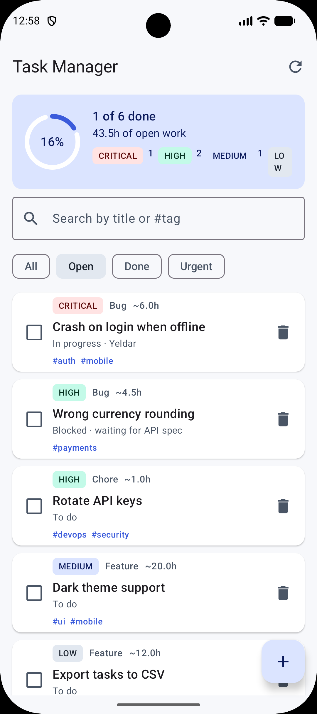
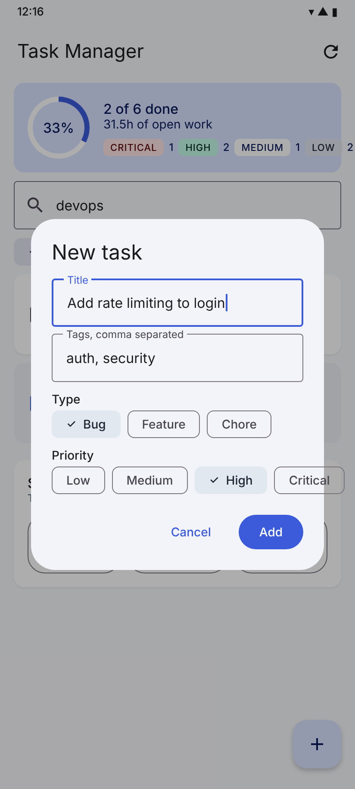

# Task Manager (Android · Jetpack Compose)

Android version of the Task Manager from Homework 1. The Kotlin domain model (`Task` hierarchy,
sealed `TaskStatus`, `ProjectReport`, `TaskRepository`) was carried over from the console project
and adapted to be immutable so it works with Compose state. The UI is built with Jetpack Compose and
Material 3, and all screen logic lives in a `ViewModel`.

| Main screen                          | Adding a task (list filtered by `devops`) |
|--------------------------------------|---|
|  |  |

## Features

- **Summary card** — completion ring, open-work estimate (sum of `estimateHours()` over open tasks)
  and a count of tasks per priority; shows a progress bar while a simulated server sync runs.
- **Search** — filters tasks by title or tag as you type.
- **Filter chips** — All / Open / Done / Urgent (urgent = open tasks with High or Critical priority).
- **Task cards** — priority badge, type, estimate, status (from the sealed class), tags;
  checkbox toggles Done, trash icon deletes.
- **Add task** — dialog with title, tags, type and priority chips; the ViewModel creates a
  `Bug`, `Feature` or `Chore` through the repository.
- **Sync** — toolbar button launches a coroutine in `viewModelScope` that calls the repository's
  `suspend fun sync()` and reports progress to the UI.
- **State survival demo** — three counters backed by `remember`, `rememberSaveable` and the
  `ViewModel`; rotate the device to see which ones survive.

## How to run

1. Open the project folder in Android Studio (Ladybug or newer).
2. Let Gradle sync (AGP 8.7.3, Kotlin 2.0.21, Compose BOM 2024.12).
3. Run the `app` configuration on an emulator or device with API 26+.

From the terminal: `./gradlew installDebug` with a connected device.

## Where the requirements are demonstrated

| Requirement | Where |
|---|---|
| Material 3, consistent styling | `ui/theme/Theme.kt` (custom light/dark color schemes), M3 components throughout |
| Reusable composables (≥3) | `ui/components/`: `TaskCard`, `StatsHeader`, `PriorityBadge`, `AddTaskDialog`, `StateDemoCard` |
| `Row`, `Column`, `Box` | `TaskCard` (Row + Column), `StatsHeader` (Box for ring + label), `EmptyState` in `TaskScreen` (Box) |
| `LazyColumn`, `Card`, `Text`, `Image` | `TaskScreen` (`LazyColumn` with keyed `items`), `TaskCard` (`Card`), `EmptyState` (`Image` from a vector drawable) |
| User interactions (≥2) | add task, search, filter chips, toggle done, delete, sync |
| Input components | `OutlinedTextField` (search, dialog), `Button`/`TextButton`/`IconButton`, `Checkbox`, `FilterChip`, `FloatingActionButton` |
| UI updates on actions | all UI reads `viewModel.uiState` via `collectAsStateWithLifecycle`; every action goes through the ViewModel |
| `remember` / `rememberSaveable` | `StateDemoCard` (both counters), `TaskScreen` (`showAddDialog`), `AddTaskDialog` (form fields survive rotation while the dialog is open) |
| `ViewModel` | `ui/screen/TaskViewModel.kt` — holds query, filter, sync progress and the counter; exposes a single `StateFlow<TaskUiState>` built with `combine` |
| Separation of UI and state | composables only render `TaskUiState` and call ViewModel functions; repository holds the data in a `MutableStateFlow` |
| Activity recreation behaviour | rotate the device with the state demo card visible, or type in the search field / open the dialog and rotate |

## `remember` vs `rememberSaveable` vs `ViewModel`

- **`remember`** keeps a value across *recompositions* only. It lives in the composition; when the
  Activity is recreated (rotation, theme change, process death) the composition is rebuilt and the
  value is lost. The "remember" counter in the demo resets to 0 on rotation.
- **`rememberSaveable`** does the same but also writes the value into the Activity's saved instance
  state `Bundle`, so it survives configuration changes and even process death. It only accepts
  `Bundle`-compatible types (primitives, `String`, `Parcelable`, `Serializable`) or a custom `Saver`.
  Good for small UI state such as text field contents, a selected tab, or whether a dialog is open.
- **`ViewModel`** lives outside the composition in the `ViewModelStore`, which is retained across
  configuration changes but *not* across process death (unless combined with `SavedStateHandle`).
  It is the right place for screen state and business logic that several composables share, for
  coroutines (`viewModelScope`) and for talking to repositories.

## Structure

```
app/src/main/java/kz/khasen/taskmanager/
  MainActivity.kt
  model/Task.kt                 Priority, TaskKind, sealed TaskStatus, Task hierarchy, ProjectReport
  data/TaskRepository.kt        StateFlow-backed storage, collection ops, suspend sync
  ui/theme/Theme.kt             Material 3 color schemes
  ui/components/                reusable composables
  ui/screen/TaskViewModel.kt    screen state and logic
  ui/screen/TaskScreen.kt       the screen
```
