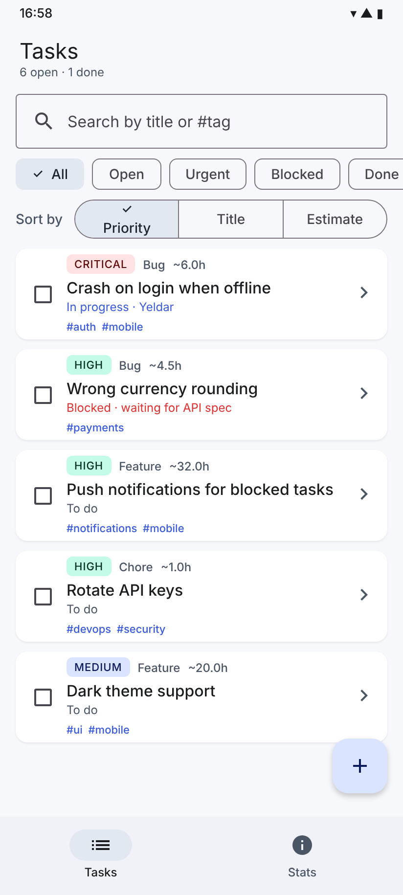
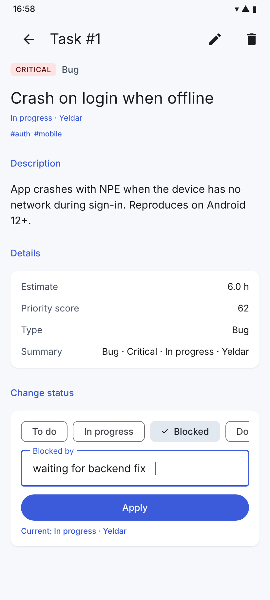
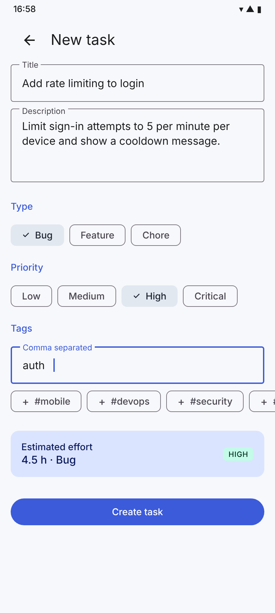
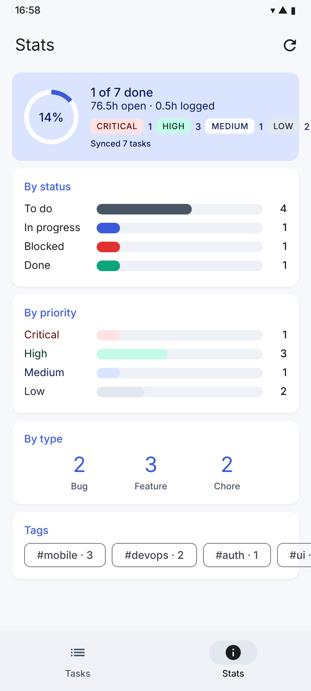
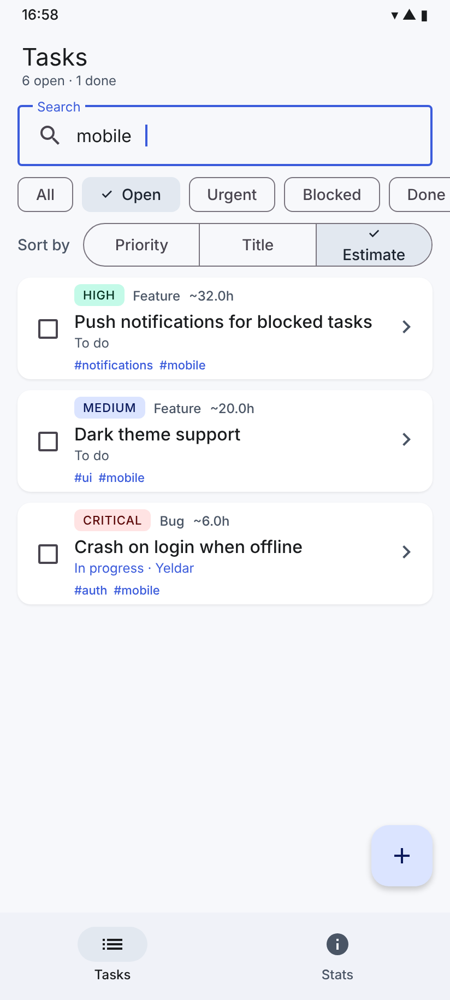

# Task Manager — Midterm Project (Android · Kotlin · Jetpack Compose)

A lightweight issue tracker for a small development team: bugs, features and chores with
priorities, tags, effort estimates and a real status workflow (To do → In progress → Blocked → Done).
It answers the questions a developer asks every morning — *what should I pick up next, what is
blocked and why, how much work is left* — without opening Jira.

This is the continuation of HW1 (console app) and HW2 (single-screen Compose app). The domain
model from HW1 (`Task` hierarchy, sealed `TaskStatus`, `ProjectReport`) is reused unchanged in
spirit; the app now has four screens connected with Navigation Compose and three ViewModels.

| Tasks | Task detail | New / edit task | Stats |
|---|---|---|---|
|  |  |  |  |

Search + filter + sort combined (open tasks tagged `mobile`, sorted by estimate):



## Features

1. **Task board with search, filters and sorting** — search by title or `#tag`; filter chips
   All / Open / Urgent / Blocked / Done; sort by priority score, title or estimate. The priority
   score is computed polymorphically (`Bug` weighs severity, `Feature` weighs story points) so the
   most valuable work floats to the top. Checkbox toggles Done directly from the list.
2. **Status workflow driven by a sealed class** — on the detail screen each status asks for the
   data it needs: *In progress* wants an assignee, *Blocked* wants a reason, *Done* wants hours
   spent. The sealed `TaskStatus` makes the `when` exhaustive, so adding a status is a compile
   error until every screen handles it.
3. **Create and edit tasks** — full-screen form with validation, type and priority chips, tag
   suggestions built from tags already used in the project, and a live effort estimate that
   updates as you change type/priority. Form state lives in `SavedStateHandle`, so it survives
   rotation and process death.
4. **Project stats** — completion ring, open vs logged hours, breakdown by status, priority,
   type and tag, top-3 open tasks by score, plus a simulated server sync (coroutine with progress).
5. **Delete with confirmation** from the detail screen.

## How to run

1. Open the project folder in Android Studio (Ladybug 2024.2 or newer).
2. Let Gradle sync — AGP 8.7.3, Kotlin 2.0.21, Compose BOM 2024.12.01, Navigation Compose 2.8.5.
3. Run the `app` configuration on an emulator or device with API 26+.

Terminal: `./gradlew installDebug` with a device connected.

## Architecture

```
app/src/main/java/kz/khasen/taskmanager/
├── TaskManagerApp.kt              Application; owns the single TaskRepository
├── MainActivity.kt                setContent { AppNavigation() }
├── model/Task.kt                  Priority, TaskKind, sealed TaskStatus, abstract Task → Bug/Feature/Chore,
│                                  TaskDraft, ProjectReport (data classes)
├── data/TaskRepository.kt         MutableStateFlow<List<Task>> + add/update/setStatus/remove,
│                                  report() with groupingBy/partition/fold, suspend sync()
└── ui/
    ├── AppViewModelProvider.kt    viewModelFactory: injects repository + SavedStateHandle
    ├── navigation/AppNavigation.kt NavHost, routes, bottom NavigationBar
    ├── components/                reusable: TaskCard, PriorityBadge, StatusLabel, TagRow, StatsHeader,
    │                              BarRow, SectionTitle, InfoRow
    ├── tasks/                     TaskListScreen + TaskListViewModel
    ├── detail/                    TaskDetailScreen + TaskDetailViewModel
    ├── edit/                      EditTaskScreen + EditTaskViewModel
    ├── stats/                     StatsScreen + StatsViewModel
    └── theme/Theme.kt             Material 3 light/dark color schemes
```

Three layers:

- **UI** (`ui/*/*Screen.kt`, `ui/components`) — stateless composables that render a `UiState`
  and call ViewModel functions. Screens hoist events up (`onTaskClick`, `onAddClick`, `onDone`)
  so navigation decisions stay in `AppNavigation`.
- **State / application logic** (`*ViewModel.kt`) — each screen has its own ViewModel exposing a
  single `StateFlow<UiState>` built with `combine(...).stateIn(viewModelScope, WhileSubscribed(5s))`.
  Filtering, sorting, validation and status transitions live here.
- **Data** (`TaskRepository`) — the one source of truth, shared through the `Application` so all
  ViewModels observe the same `StateFlow` and every screen updates when any screen changes data.

### Navigation

| Route | Screen | Arguments |
|---|---|---|
| `tasks` | `TaskListScreen` | — (bottom-bar destination, start) |
| `stats` | `StatsScreen` | — (bottom-bar destination) |
| `task/{taskId}` | `TaskDetailScreen` | `taskId: Int` |
| `edit?taskId={taskId}` | `EditTaskScreen` | optional `taskId`, `-1` = new task |

Bottom-bar navigation uses `popUpTo(startDestination) { saveState = true }` + `launchSingleTop`
+ `restoreState`, so switching tabs keeps each tab's scroll and state. Detail and edit screens
read `taskId` through `SavedStateHandle` in their ViewModels, not from the composable.

### State management: where each piece of state lives and why

| State | Holder | Reason |
|---|---|---|
| Task list, search query, filter, sort | `TaskListViewModel` (`StateFlow`) | shared by several composables, survives rotation |
| Form fields of the edit screen | `EditTaskViewModel` via `SavedStateHandle.getStateFlow` | survives rotation **and** process death |
| Selected status chip + its text field on detail | `rememberSaveable` in `StatusEditor` | purely local UI state, still survives rotation |
| "Delete?" dialog visibility | `rememberSaveable` in `TaskDetailScreen` | local, must survive rotation |
| Scroll positions | `rememberScrollState` / `LazyColumn` state (`remember`) | transient; restored by Navigation's `saveState` |
| Sync progress | `StatsViewModel` | tied to a coroutine in `viewModelScope` |

All screens collect with `collectAsStateWithLifecycle()`, so collection stops when the
screen is in the background.

### Configuration changes

Rotate the device on any screen: the list keeps its query/filter/sort (ViewModel), the edit form
keeps every field (SavedStateHandle), the detail screen keeps the selected status chip and the
typed reason (`rememberSaveable`), and an in-flight sync keeps running and reporting progress
(`viewModelScope` is not cancelled on rotation).

## Kotlin language features used

- Inheritance + polymorphism: `Task` → `Bug`, `Feature`, `Chore` override `estimateHours()`, `bonus()`, `copyWith()`.
- Interfaces: `Describable`, `Estimable`.
- Sealed class `TaskStatus` with data objects/classes; sealed interface `TaskDetailUiState`.
- Data classes: `TaskDraft`, `ProjectReport`, every `UiState`.
- Collections: `List`, `Set` (tags), `Map` (reports); `filter`, `map`, `sortedBy`, `partition`, `groupingBy().eachCount()`, `flatMap`, `fold`, `take`, `associate`.
- Higher-order functions and lambdas throughout (`combine`, `onProgress: (Int) -> Unit`, event callbacks).
- Coroutines: `suspend fun sync()` with `delay`, `viewModelScope.launch`, `StateFlow`/`combine`/`stateIn`.
